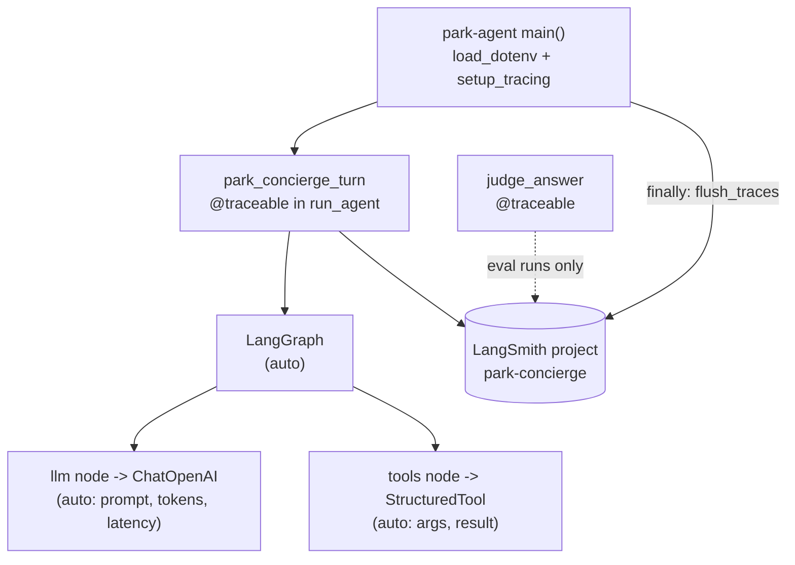
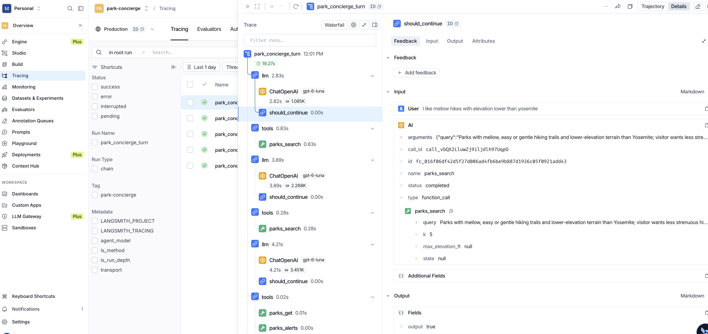

# LangSmith integration

Tracing for park-concierge: run `uv run park-agent "..."` and watch the whole turn - graph steps, model calls, tool calls, tokens, latency - appear in LangSmith.


## How it works

LangChain and LangGraph have LangSmith built in. With `LANGSMITH_TRACING=true` and an API key in the environment, every model call, tool call and graph node is recorded automatically. The code adds only a root span, metadata, and a flush.



## Every connection point in the code

| # | File | What | Why |
|---|---|---|---|
| 1 | `.env` / `.env.example` | `LANGSMITH_TRACING`, `LANGSMITH_PROJECT`, (`LANGSMITH_API_KEY`) | Master switch, destination project, credentials |
| 2 | `pyproject.toml` | `langsmith>=0.4` dependency | Was only a transitive dep of langchain-core; now explicit because we import it |
| 3 | `src/park_core/tracing.py` | `setup_tracing()`, `flush_traces()`, `tracing_enabled()` | Validates config, defaults the project name, logs status, flushes at exit |
| 4 | `src/park_agent/__main__.py` `main()` | `setup_tracing()` after logging config; `flush_traces()` in `finally` | Must run before the first model call; CLI exits quickly and would lose the tail of the trace |
| 5 | `src/park_agent/graph.py` `run_agent` | `@traceable(name="park_concierge_turn")` + metadata `agent_model`, `transport` | One root run per question, so each turn is a single trace you can filter by model or stdio vs in-process |
| 6 | `src/park_agent/graph.py` `build_graph` | Nothing - automatic | LangGraph emits `LangGraph` > `llm` / `tools` / `should_continue` spans, and nested `ChatOpenAI` and per-tool spans |
| 7 | `src/park_evals/judge.py` `judge_answer` | `@traceable(name="judge_answer", tags=["eval","judge"])` | Judge calls appear as their own traces when evals run with tracing on |
| 8 | `src/park_agent/__main__.py` `FORWARDED_ENV` | LangSmith vars deliberately **not** forwarded | See "Gotchas" |

## Environment variables

| Variable | Required | Value |
|---|---|---|
| `LANGSMITH_API_KEY` | yes | Your key (currently in your shell environment; `load_dotenv` does not override it) |
| `LANGSMITH_TRACING` | yes | `true` to record; unset or `false` for no tracing |
| `LANGSMITH_PROJECT` | no | Defaults to `park-concierge`. Auto-created on first trace |
| `LANGSMITH_ENDPOINT` | no | Default is US (`https://api.smith.langchain.com`). |
| `LANGSMITH_WORKSPACE_ID` | only if key is org-scoped | Workspace ID from Settings in the portal |

Older `LANGCHAIN_*` names still work but `LANGSMITH_*` is current.

## Portal setup

Nothing is required up front: the project is created automatically on the first trace.

Optional, worth doing now:

1. **Confirm the key** - Settings > API Keys. A personal access token works. If you create a service key, scope it to the workspace you want and set `LANGSMITH_WORKSPACE_ID` if you get 403s.
2. **Check the workspace** - the traces land in the workspace the key belongs to. The org URL above is the org; switch workspace from the top-left selector if you have several.
3. **Pre-create the project** (optional) - Tracing > New Project > `park-concierge`, if you want to set a description or retention up front.

## Run it and find the trace

```bash
uv run park-agent --inprocess "Customer 1042 is planning a trip in March. Where should they go?"
```

Look for `LangSmith tracing is on -> project 'park-concierge'` in the log output. Then in the portal:

1. **Tracing** (left nav) > project **park-concierge**.
2. Open the newest run named `park_concierge_turn`.
3. The tree shows the loop: `LangGraph` > `llm` > `ChatOpenAI` > `tools` > `customer_lookup`, `parks_search`, `parks_alerts` > `llm` again.
4. Click any `ChatOpenAI` span for the exact prompt, tool-call JSON, token counts and latency; click a tool span for args and result.

Useful views:

| Where | Use |
|---|---|
| Project > filter `metadata.transport = stdio` | Compare subprocess vs in-process runs |
| Project > Monitor tab | Latency, token and error charts over time |
| Run > "Playground" button on a `ChatOpenAI` span | Replay and tweak the system prompt on a real captured input |
| Run > "Add to dataset" | Seed for the eval work: capture good questions as dataset examples |

## Stdio vs in-process

- **`--inprocess`**: one process, one trace tree. Tool spans nest fully.
- **Default (stdio)**: the agent still traces everything on its side, including each tool call and its result. The `park-mcp` subprocess is **not** traced separately.

## Gotchas

- **Flush on exit.** Uploads happen on a background thread; `flush_traces()` blocks until done. If you add a new entry point, call it.
- **Call `setup_tracing()` after `load_dotenv()` and before the first model call.** LangSmith caches its config.
- **LangSmith vars are not forwarded to the MCP subprocess.** The server's embedding calls would otherwise emit orphan traces unconnected to the agent turn. Add the vars to `FORWARDED_ENV` only if you want that.
- **The fast pytest suite does not trace.** Tests never call `load_dotenv`, so tracing is on only if `LANGSMITH_TRACING` is in your shell. For `pytest -m eval`, run with `LANGSMITH_TRACING=true LANGSMITH_API_KEY=... uv run pytest -m eval` to trace; scenarios will not be grouped yet (that comes with evals).
- **Traces contain full prompts and tool output**, including customer records from Postgres. Fine for this demo; for real data, use LangSmith's input/output masking or keep tracing off.
- **Turn it off** with `LANGSMITH_TRACING=false`. Missing key with tracing on logs a warning and disables tracing rather than failing.

## Next: evals in the console

Natural follow-ups, none done yet: create a dataset from the five YAML scenarios, run them with `langsmith.evaluate()` so each run becomes an experiment, and port the deterministic `check_trace` checks and the per-criterion judge to LangSmith evaluators.


# Screenshot from LangSmith


 