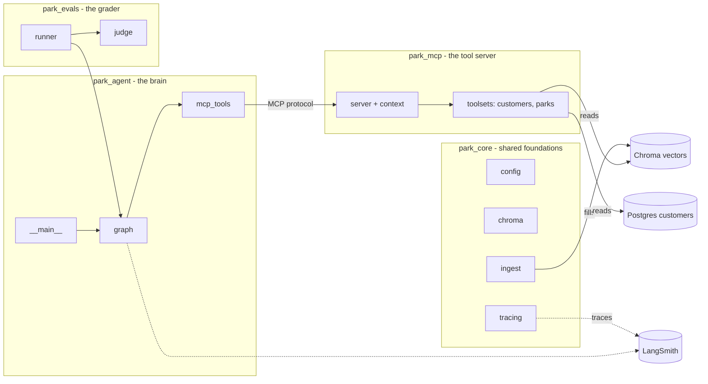
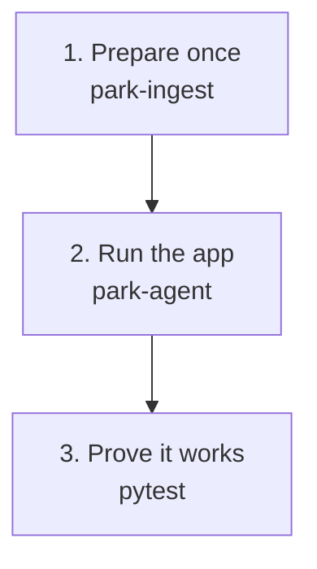
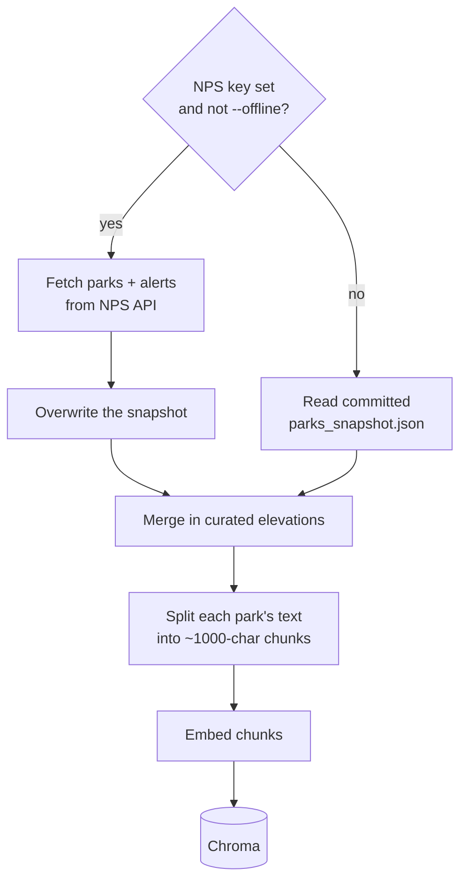
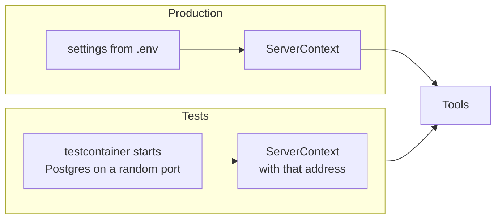
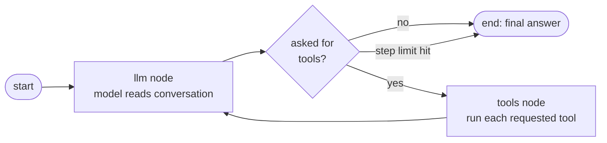
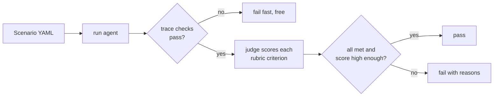
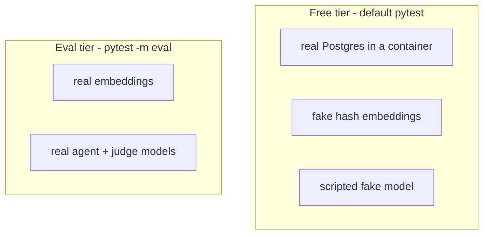
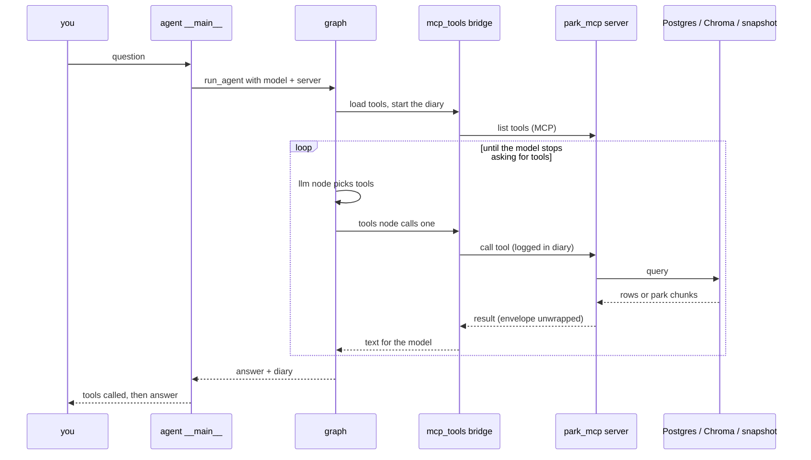
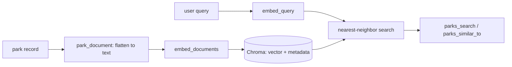
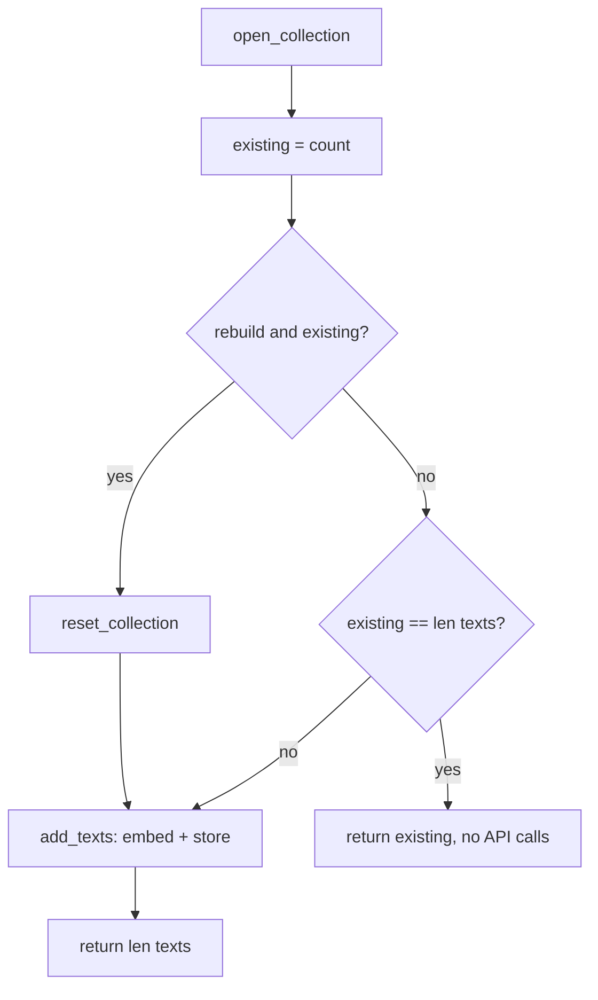

# Code tour: what every Python file does

A study guide, file by file, in plain English. Read it top to bottom once, then use it as a map.

## The big picture

The project answers questions like "Customer 1042 wants a March trip - where should they go?". Four packages cooperate, plus a test suite.

The idea in one sentence: **an LLM (the agent) decides which tools to call; the tools live in a separate MCP server; they read customer data from Postgres and park knowledge from a vector database; and an eval suite checks that the agent behaved.**

### Where things get read from

| Question the agent has | Data source | Why there |
|---|---|---|
| Who is this customer, what are their limits? | Postgres | Structured, internal records |
| Which parks feel like "warm, low, accessible"? | Chroma vector DB | Fuzzy meaning is what vectors are good at |
| What are a park's alerts and exact elevations? | JSON snapshot file | Exact facts, not worth searching by similarity |

### Three lifecycles

1. **Prepare:** `ingest.py` turns park data into vectors.
2. **Run:** `park_agent` asks the model, the model calls tools in `park_mcp`.
3. **Prove:** `tests/` and `park_evals/` check wiring (free) and answer quality (costs tokens).

---

## park_core - shared foundations

Code both the server and the agent depend on, so they cannot disagree.

### `park_core/__init__.py`
An almost empty marker that makes the folder a package.

### `park_core/config.py`
The single place environment settings are read: database address, vector store folder, collection name, the embedding model, the agent model, the judge model and the NPS key. Each has a sensible default. It also works out the project root folder from its own location, so paths do not depend on where you launched the program.

Key point: the settings are read **once, when the file is first imported**. That is convenient in production but is why the tools do not read settings directly (see `context.py`). A side effect worth knowing: if the file is imported before `.env` is loaded, values in `.env` are missed.

### `park_core/chroma.py`
The one gate to the vector database. It does four jobs:

1. **Opens the parks collection** - the same way for everyone. Ingest writes to it and the search tools read from it; if each picked their own name or embedding model, searches would silently find nothing.
2. **Provides the real embeddings** (OpenAI), imported only when needed so the free tests never require a key.
3. **Provides a fake embedding class for tests.** It turns words into numbers by hashing them. It does not understand meaning, but similar wording lands nearby, which is enough to prove the plumbing works for free.
4. **Defines how a park becomes searchable.** One function flattens a park record into the text that gets embedded (name, description, activities, topics, weather, elevation range). Another builds the metadata attached to it (park code, state, numeric elevation). The numeric elevation is what allows a true "under 5,000 ft" filter instead of hoping the embedding understands numbers.

### `park_core/ingest.py`
The one-time loader that fills the vector database. It is what `park-ingest` runs.

Notable behaviours:
- Only parks designated "National Park" are kept from the live API.
- The NPS API has no elevation field, so a hand-curated file is merged in on both paths, making live and offline behave the same.
- Parks are cut into overlapping chunks, so one park may become several vectors.
- If the collection already has the right number of chunks, it does nothing (embeddings cost money). `--rebuild` forces a redo.
- The embedding model can be swapped for the fake one, which is how tests build a store offline.

### `park_core/tracing.py`
Added for LangSmith. It decides whether tracing is on (switch plus API key), sets the default project name, logs a status line, and provides a "flush" that waits for queued traces to upload before a short program exits. Details are in `docs/langsmith.md`.

---

## park_mcp - the tool server

MCP (Model Context Protocol) is a standard way for an AI app to discover and call tools hosted elsewhere. This package is the "elsewhere": it advertises seven read-only tools. It can run as its own process, which is why the agent talks to it across a real boundary.

### `park_mcp/__init__.py`
Package marker.

### `park_mcp/__main__.py`
The startup script for `park-mcp`. It loads `.env`, sends logs to stderr (never stdout, because on the stdio transport stdout is the protocol channel and a stray print would corrupt it), builds the server and runs it over stdio or HTTP.

### `park_mcp/server.py`
Builds the server: creates the MCP server object, gives it a short instructions text, and registers the toolsets. Choose which toolsets to include, or take them all.

### `park_mcp/context.py`
Defines the **ServerContext**: a bundle of everything the tools need (database address, vector store location, snapshot path, optional embeddings). It also defines the "read only" label stamped on every tool.

Why it exists is the most important design idea in the project:

The tests start a throwaway Postgres whose address is only known after the test starts. If tools read the global settings, they would quietly hit the developer's real database and still pass. So the address is **handed in as data**.

The context also loads the park snapshot and elevation file on first use, and opens the vector store lazily. Laziness means the server can start and answer some questions with no OpenAI key; only tools that embed a query need one.

### `park_mcp/toolsets/__init__.py`
A registry. A toolset is a module that knows how to add its tools to a server. This file keeps the list of known toolsets, imports the requested ones on demand, and rejects unknown names. Adding a new toolset (say, weather) is: write a module, add one line here. It also holds a helper that unwraps the MCP result envelope: non-dictionary results (lists, strings) come back wrapped as "result: ...", and the helper removes that wrapper.

### `park_mcp/toolsets/customers.py`
The Postgres side. Three tools:

| Tool | Does |
|---|---|
| `customer_lookup` | One customer by id: tier, home state, party size, accessibility needs, elevation limit |
| `customer_find_by_email` | Same, found by email, ignoring case |
| `customer_visits` | Past visits, newest first, with ratings |

Safety: every query runs on a **read-only connection**, so the database itself refuses writes even if the SQL were wrong. Row counts are capped. Missing customers return nothing (null) rather than an error, and the tool's description tells the model not to invent one. The tools are defined inside a registration function so they can use the injected context.

### `park_mcp/toolsets/parks.py`
The knowledge side. Four tools:

| Tool | Does | Reads from |
|---|---|---|
| `parks_search` | Finds parks matching a description by meaning | Vector DB |
| `parks_similar_to` | "They loved Zion, what else?" - nearest neighbours of a park | Vector DB |
| `parks_get` | Full record for one park | Snapshot |
| `parks_alerts` | Closures, road status, hazards | Snapshot |

Details worth studying:
- **Soft vs hard preferences.** "Somewhere warm" goes in the query text; "nothing above 5,000 ft" is a **filter**. Both search tools take the same filters so the result does not depend on which tool the model picks.
- **Deduplication.** Because parks are chunked, a search may hit the same park three times. Results are collapsed to one entry per park, best first. The search fetches extra chunks up front to leave enough after deduping.
- **Clamping.** The number of results is limited to a sane range.
- **Tool descriptions are prompts.** The docstrings are what the model reads to decide when and how to call a tool, so they are written as instructions.

---

## park_agent - the brain

### `park_agent/__init__.py`
Empty package marker.

### `park_agent/graph.py`
The agent loop, built with LangGraph. It contains the system prompt (the concierge's rules), the loop, and the function that runs one question end to end.

Pieces:
- **The system prompt** - the concierge's rules: look up the customer first, never invent customers or parks, offer two or three options, pass the elevation limit as a filter, check alerts for every park recommended, refuse off-topic questions.
- **State** - the running list of messages plus a step counter.
- **The llm node** - sends the system prompt and conversation to the model.
- **The tools node** - runs each requested tool and appends the result as a message. An unknown tool name produces a polite error message to the model, not a crash.
- **The step limit** - at most eight model turns, so a confused model cannot loop forever.
- **The run function** - opens a connection to the MCP server, loads its tools, builds and runs the graph, and returns an "AgentRun": final answer, record of tool calls, and message history. It requires you to say which server to use (no default) so the evals can never accidentally test your real database. It is also the **root LangSmith span** for a turn.

### `park_agent/mcp_tools.py`
The bridge between two worlds: MCP tools and LangChain tools. It asks the server what tools exist and wraps each as something the graph understands, using the server's own descriptions and parameter definitions so the model knows how to call them.

The wrapper also **keeps a diary**, the ToolTrace:
- the ordered list of every tool call and its arguments (what the cheap deterministic eval checks use), and
- the results from the search and alert tools (the "retrieved context" the judge later treats as the only truth).

It also unwraps the MCP envelope, stamps alert results with their park code (they come back without one), and turns tool failures into text the model can read. It is hand-written rather than a library on purpose: it is short, and it is what makes the trace possible.

### `park_agent/__main__.py`
The command line for `park-agent`. It picks how to reach the server: **stdio** (default, starts `park-mcp` as a real subprocess) or **in-process** (`--inprocess`, handy for debugging). For the subprocess it explicitly forwards a short list of environment variables, because the stdio client does not pass your environment on. It creates the model with temperature zero, runs the question, prints tools called then the answer, and warns if the step limit hit. With no question it becomes a REPL. It also switches on LangSmith tracing and flushes at exit.

---

## park_evals - the grader

Automated quality checks on the agent's answers.

### `park_evals/__init__.py`
Package marker.

### `park_evals/scenarios/*.yaml`
Not Python, but the heart of the evals: five test cases, each with a prompt, a rubric of things a good answer does, and rules about which tools must or must not be called.

| Scenario | Tests |
|---|---|
| warm_march_accessible | Happy path with accessibility and elevation constraints |
| similar_to_zion | Likeness search and staying grounded |
| unknown_customer | A missing customer is not invented |
| alert_blocks_recommendation | A closure is surfaced |
| off_topic_guard | Unrelated questions are declined |

### `park_evals/runner.py`
Loads scenarios from disk in stable order, runs the agent on one, and applies the **cheap deterministic checks** to the tool trace: required tools called, forbidden tools not called, step limit not hit. These run first because wiring failures should fail fast and for free.

### `park_evals/judge.py`
The **LLM-as-judge**. A second, cheaper model reads the question, the retrieved context and the agent's answer, then rules on each rubric criterion separately: met or not, with a one-sentence reason. The score is arithmetic (criteria met out of total, scaled to 5), and all criteria must be met to pass. Design lessons captured in the file:
- Grading one criterion at a time fixed a problem where the judge mangled phrases like "at least two" when weighing everything at once.
- The judge uses a different model from the agent, to avoid a model rubber-stamping its own reasoning.
- The judge may only treat the retrieved context as true, so invented parks count as hallucinations.
- If the judge returns the wrong number of rulings, it raises an error instead of averaging over the wrong count.

---

## tests - the safety net

Two tiers. The default tier is free and needs no OpenAI key; the eval tier spends tokens (`-m eval`).

### `tests/conftest.py`
Shared setup. Starts a throwaway Postgres 17 and loads the schema; builds a vector store from the snapshot using fake embeddings; assembles a ServerContext pointing at both; and locates the real store for evals (skipping if you have not run ingest). This is where the "pass the address in as data" design pays off.

### `tests/support.py`
A **scripted fake chat model**. It replays a fixed list of replies, such as "call this tool" then "here's the answer", so the agent loop can be tested with no real model. It gives every replayed message a fresh id because the graph merges messages by id and a repeated id would overwrite the previous turn.

### `tests/test_customers_toolset.py`
Checks the Postgres tools against the real container: toolset selection, building a server twice works, lookups, case-insensitive email, newest-first visits, capped limits, and that every tool is labelled read-only.

### `tests/test_parks_toolset.py`
Checks the park tools: distinct results, clamped result counts, state and elevation filters (alone and combined), full record contents, alerts, "similar to" excluding itself, respecting filters, unknown parks returning empty, and alert counts appearing in results.

### `tests/test_agent_graph.py`
Checks the loop using the scripted model: it calls a tool then answers, tool results reach the model, retrieval results are captured as grounding, the envelope is unwrapped, a runaway loop is stopped, unknown tools are reported not raised, and tool errors reach the model as text.

### `tests/test_stdio_smoke.py`
One round trip over the **real stdio transport**, starting the server as a subprocess. In-process tests skip the protocol layer, so they could never catch a tool returning something unserializable or a stray print corrupting the stream. It only uses tools needing no credentials.

### `tests/test_evals.py`
The paid tier. For each scenario: build a server with the container Postgres and the real embedded store, run the real agent, run the cheap trace checks, then run the judge and assert it passed with a high enough score. Much of its length is explanation of a nasty problem: the OpenAI client is tied to an event loop, each test gets a new one, so the HTTP client is created and closed explicitly inside each test.

---

## Non-Python files 

| File | Role |
|---|---|
| `db/init.sql` | Creates and seeds the customer and visit tables |
| `compose.yaml` | Runs Postgres locally on port 5433 |
| `data/parks_snapshot.json` | Committed copy of park data and alerts, so everything runs offline |
| `data/park_elevations.json` | Hand-curated elevation ranges |
| `data/chroma/` | The generated vector database (git-ignored) |
| `.mcp.json` | Registers the MCP server with Claude Code |
| `docs/langsmith.md` | LangSmith tracing guide |

## Following one question through every file

## Suggested reading order

1. `config.py`, then `chroma.py` - the data foundations.
2. `ingest.py` - how the knowledge gets in.
3. `context.py`, `toolsets/customers.py`, `toolsets/parks.py` - the tools.
4. `mcp_tools.py`, then `graph.py` - the agent.
5. `runner.py`, `judge.py`, one scenario YAML - the evals.
6. `conftest.py`, `support.py`, then `test_agent_graph.py` - how it is tested for free.

---

# more study..

---

